<div align="center">

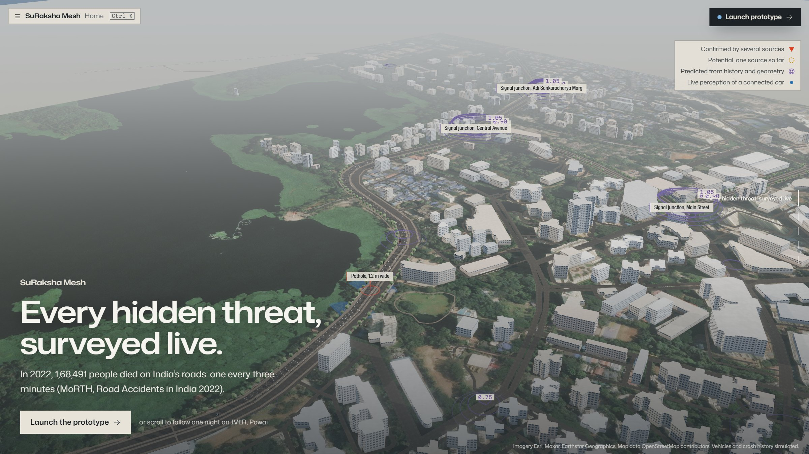

# SuRaksha Mesh

### Every hidden threat, surveyed live.

A virtual V2X network that turns the cars and phones already on Indian roads into one lane-level, live picture of the road, and tells each driver only what is in their lane, before they can see it.


**Maruti Suzuki Innovation × IIT Bombay E-Summit Ideathon 2026** · AI, IoT and Intelligent Urban Mobility

[The problem](#the-problem) · [Features](#features) · [Impact](#impact) · [The product](#the-product) · [How it works](#how-it-works) · [The engine](#the-threat-intelligence-engine) · [Run it](#run-it) · [Docs](#documentation)

</div>

---

## The problem

In 2022, **1,68,491 people died on India's roads**: one every three minutes (MoRTH, *Road Accidents in India 2022*). Much of what kills is out of sight at the moment it matters:

- a pedestrian stepping out from behind a stopped bus
- a barricade put up overnight that is on no map
- a pothole hidden under monsoon water
- a free-left turn where people keep getting hit

A driver sees about 100 metres. **Some car nearby has usually already seen the danger**, but that knowledge dies inside that car. India has almost no roadside V2X infrastructure, and it is years away.

## The idea

**Use what is already on the road.** Dashcams, accelerometers, connected cars (Suzuki Connect) and residents' phones report what they see. A fusion engine decides what is a rumour and what is a fact. Each driver hears only what is on their route, in their lane, in the next minute.

| | |
|---|---|
| **No new hardware** | Cars and phones that already exist. Cellular "V2X-lite", no roadside units. |
| **Honest confidence** | One report is said as "possible". Two independent sources make it "confirmed". |
| **Sees what nobody named** | Three different cars swerving at one spot become an "unknown obstacle". |
| **Closes the loop** | Hazards become ranked city work orders; passing cars verify the repair. |

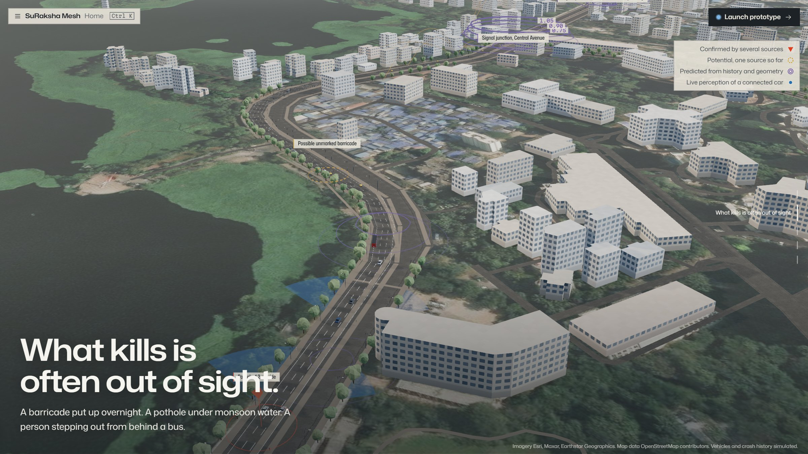

---

## Features

Everything below runs in the prototype today. Routes are in brackets; press `Ctrl/Cmd + K` anywhere to jump.

### For drivers

| Feature | What it does |
|---|---|
| **Road Ahead** (`/drive`, `/car`, `/app`) | Only what is on your route, in or next to your lane, within the next minute, ranked critical, advisory or info by stopping distance, and longer in rain |
| **Confidence-aware alerts** | Confirmed hazards are named ("Unmarked barricade, lane 1, 54 m"); single reports are said as "possible"; predicted risks name their history |
| **See-through view** | When the car ahead sees what you cannot, its view appears in your windshield display |
| **Lane guidance** | "Bus stopped in lane 1 ahead. Move to lane 2" before the last second |
| **Voice and directional chimes** | Spoken alerts; the chime comes from the side of the road the threat is on |
| **Driver monitoring** | Webcam fatigue detection on device (eye closure, microsleep, yawns); a microsleep also warns cars nearby |
| **Safer route** | Real routes compared by risk per km, not only time, with the hazards on each named |
| **Monsoon warning** | Waterlogging advisories at low points before heavy rain arrives |

### For residents and every phone

| Feature | What it does |
|---|---|
| **Dashcam AI** (`/dashcam`) | The phone camera, or a dashcam video, detects people, animals, potholes, barricades and water on device; only the result is shared |
| **Phone as a road sensor** (`/app`) | Accelerometer jolts become pothole reports, matched to the right lane |
| **Photo reports** | Report a pothole, barricade, broken footpath, open manhole or waterlogging in three taps, then follow its status from "noticed" to "repaired" |
| **Street Guardian points** | 20 points per report, 50 more when the network confirms it |
| **Works offline** | Installable app; reports made without signal are queued and sent later |

### For the city

| Feature | What it does |
|---|---|
| **Operations console** (`/ops`) | Lane-level fused view, every threat with its sources and confidence, incoming reports with photos |
| **Work orders and repair verification** | Dispatch a crew, mark it repaired; passing cars confirm the road is clear |
| **Blackspots** | Ranked predicted-risk segments from road geometry and crash history |
| **Monsoon watch** | 6-hour rain forecast over the lowest road points, with a rehearsal mode |
| **Export** | GeoJSON and CSV of live threats and work orders for municipal systems |

### The network underneath

| Feature | What it does |
|---|---|
| **Threat Intelligence Engine** | Groups reports by place and kind, fuses independent sources, decays stale evidence, runs the lifecycle noticed → potential → confirmed → resolved |
| **Sees what nobody named** | Three different cars swerving at one spot become an "unknown obstacle" |
| **Map matching** | Every report snapped to its carriageway and lane |
| **One clock, every device** | A phone, a laptop and a projector show the same scenario second without pairing; reports sync across devices on Vercel |

### For the demo and the jury

| Feature | What it does |
|---|---|
| **City twin** (`/twin`) | Real satellite imagery of Powai, 352 OSM buildings, X-ray sensor wave, risk terrain, near-miss heat, day, dusk, night, rain and "Live Powai" weather |
| **Scroll story** (`/`) | One continuous camera move from the city to street level while the scenario plays |
| **Fusion Lab** | Add evidence and watch the real engine decide, with an autoplay for the pitch |
| **One car vs the network** | Drag a divider between what your car sees and what the network knows |
| **Director** (`/director`) | Scenario clock, story beats, QR code for the jury's phones |

---

## Impact

### What earlier warning buys

In the prototype's own scenario, the car ahead and an oncoming car confirm the pedestrian behind the bus **4.6 seconds before the driver's own camera can see them** (22.9 s against 27.5 s). At 40 km/h that is about **51 metres** of extra warning, roughly twice the 26 metres a car needs to react and stop on a dry road. The same holds for a barricade around a curve or a pothole under water: the hazard is known before it is visible.

### Why it can scale in India

| Barrier today | How SuRaksha Mesh gets around it |
|---|---|
| Roadside V2X units are expensive and years away | Uses cars and phones already on the road; the network is software |
| Hazard reports are noisy and easy to ignore | Fusion needs independent sources; single reports are said softly; stale ones fade |
| Cities learn about potholes from complaints, late | A ranked, evidence-backed work queue, and passing cars verify the repair |
| Monsoon flooding surprises drivers every year | Forecast over measured low points warns before the water arrives |
| Pedestrians are hit where footpaths end | Predicted risk at bus-stop crossings and junctions; warnings before a person is visible |

### Who it pays off for

- **Drivers:** fewer surprises, warnings that are rarely wrong, a safety score that rewards smooth driving.
- **Maruti Suzuki:** an ADAS-style safety feature for every Suzuki Connect car with no added hardware; road intelligence from the largest connected fleet in India; a reason to stay connected.
- **Cities and NHAI:** a live map of road defects with evidence, repair verification, and blackspot data for engineering fixes.
- **Residents and pedestrians:** a channel that turns a photo into a repair, and warnings to drivers where footpaths end.

### How a pilot would measure it

These are the metrics to track on one corridor; they are targets to measure, not results claimed.

| Metric | How it is measured |
|---|---|
| Warning lead time | Seconds between network confirmation and the driver's own camera detection |
| Harsh braking near confirmed hazards | Connected-car telematics before and after alerts are enabled |
| False alert rate | Confirmed threats later cleared by passing cars without a repair |
| Time from report to repair | Citizen report timestamp to crew "repaired" plus pass-by verification |
| Coverage | Share of corridor kilometres seen by at least two sources per hour |

---

## The product

One shared world, eight live surfaces. Every device follows the same scenario second, so a phone, a laptop and a projector agree without pairing.

<table>
<tr>
<td width="50%"><br/><b>Landing story</b> · scroll from the city down to the bus while the scenario plays</td>
<td width="50%">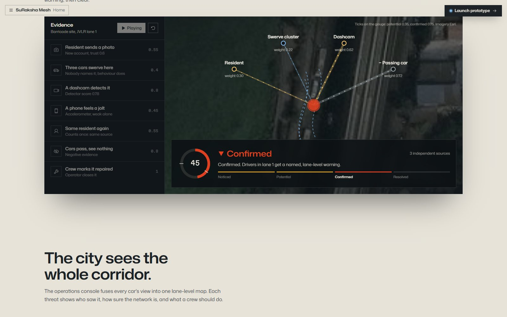<br/><b>Fusion Lab</b> · add evidence, watch the real engine decide</td>
</tr>
<tr>
<td>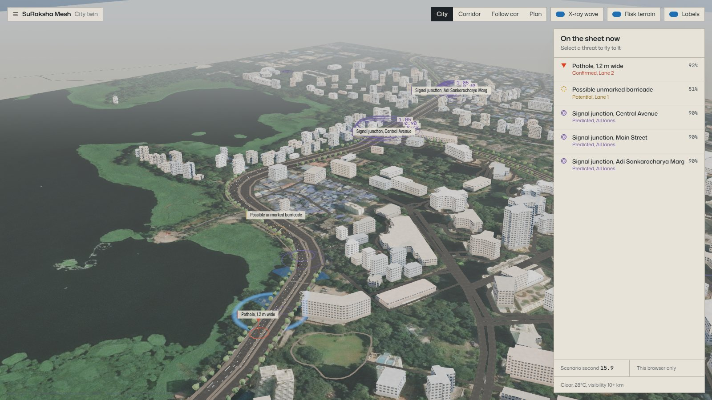<br/><b>City twin</b> <code>/twin</code> · satellite imagery, risk terrain, X-ray sensor wave</td>
<td><br/><b>Operations</b> <code>/ops</code> · fused lane-level view, sources, work orders, blackspots</td>
</tr>
<tr>
<td><br/><b>Cockpit</b> <code>/drive</code> · night HUD, voice alerts, webcam fatigue detection</td>
<td><br/><b>In-dash screen</b> <code>/car</code> · 1920 × 720, glanceable at speed</td>
</tr>
<tr>
<td><br/><b>Driver chapter</b> · "Your car hears it before the bus clears"</td>
<td>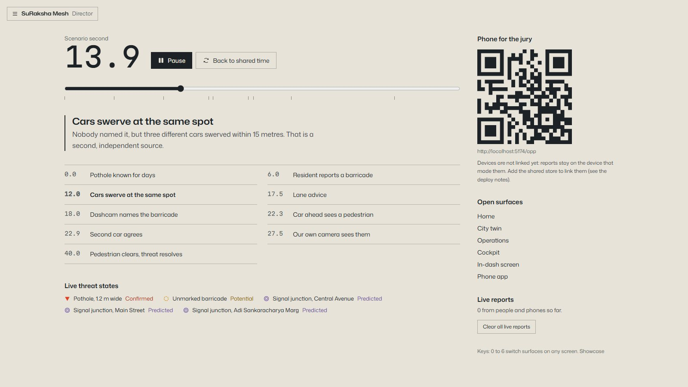<br/><b>Director</b> <code>/director</code> · scenario clock, story beats, QR for the jury</td>
</tr>
</table>

<table>
<tr>
<td width="50%"><br/><b>Night and monsoon</b> · time of day, rain and wet roads, or "Live Powai" from real weather</td>
<td width="50%"><br/><b>Near-miss heat</b> · 30 days of harsh braking as hexagon columns</td>
</tr>
</table>

<table>
<tr>
<td width="70%">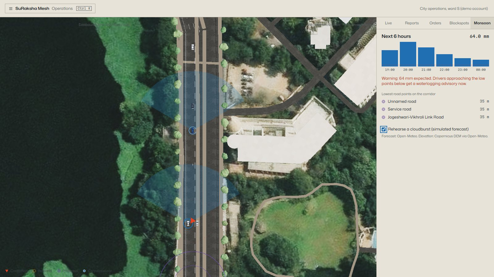<br/><b>Monsoon early warning</b> · rain forecast over the lowest road points raises waterlogging warnings before the water arrives</td>
<td width="30%">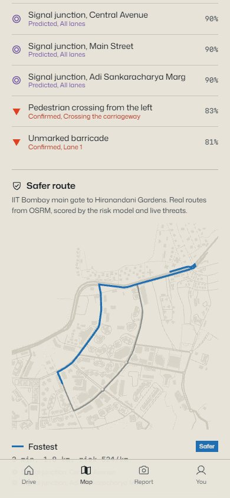<br/><b>Safer route</b> · real OSRM routes scored by risk</td>
</tr>
</table>

<p align="center">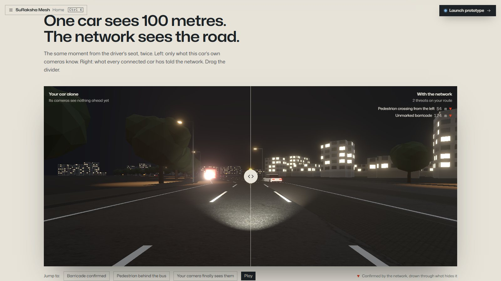<br/><b>One car vs the network</b> · drag the divider: your cameras alone, or everything the network knows</p>

<p align="center">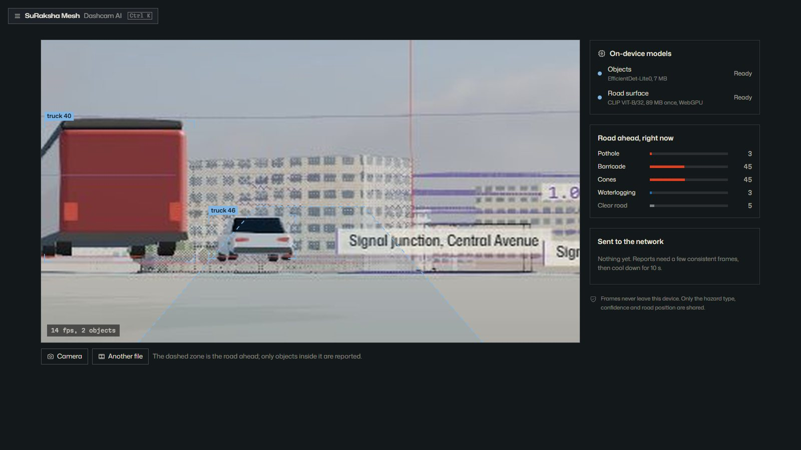<br/><b>Dashcam AI</b> <code>/dashcam</code> · on-device detection: EfficientDet objects every frame, CLIP road-surface check, strict gate, then the engine</p>

<p align="center"><br/><b>Command palette</b> · Ctrl/Cmd + K: surfaces, threats, story moments, layers</p>

<p align="center"><br/><b>Phone app</b> <code>/app</code> · Road Ahead, camera reports, the phone's accelerometer as a road sensor</p>

### What is real and what is simulated

| Real in the prototype | Simulated for the demo |
|---|---|
| Threat Intelligence Engine: association, fusion, decay, lifecycle, implicit obstacles, driver relevance (unit-tested) | Vehicle tracks on JVLR and their dashcam detections |
| OpenStreetMap roads, lanes, 352 buildings, signals and bus stops of Powai | Crash history behind the predicted risk zones (labelled synthetic) |
| Esri satellite imagery; Google photoreal 3D tiles when a key is set | Resident reports and swerve events inside the scripted scenario |
| Live weather from Open-Meteo (rain lengthens stopping distance) | |
| Webcam fatigue detection and Dashcam AI object and road-surface detection (on device) | |
| Phone accelerometer, camera reports, offline outbox, OSRM routes, Open-Meteo rain forecast and elevation | |

---

## How it works

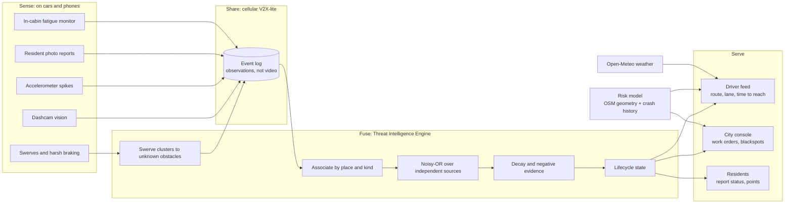

### The night on JVLR (48-second scenario)

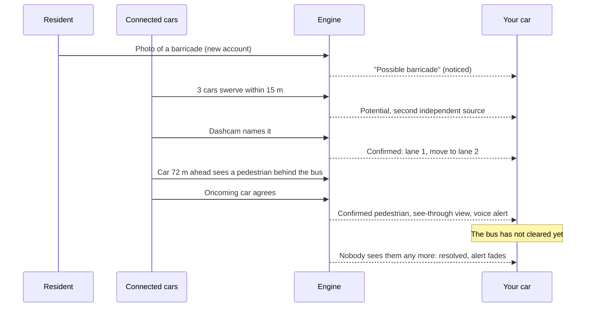

---

## The Threat Intelligence Engine

Every input is an observation: kind, place, time, source, confidence. The engine is pure TypeScript in [`app/src/engine`](app/src/engine) with 20 unit tests.

**Evidence from one source** decays with a half-life that depends on the hazard (seconds for a pedestrian, weeks for a pothole):

$$e_s = R_{\text{source}} \cdot c \cdot \rho \cdot 0.5^{\,\Delta t / T_{1/2}(\text{kind})}$$

**Fusion** is a noisy-OR across *independent* sources (a device reporting five times still counts once), and passing cars that see nothing pull it down:

$$\text{conf} = \Big(1 - \prod_{s}(1 - e_s)\Big)\cdot\prod_{k \in \text{clears}}\big(1 - 0.6\,R_k c_k\big)$$

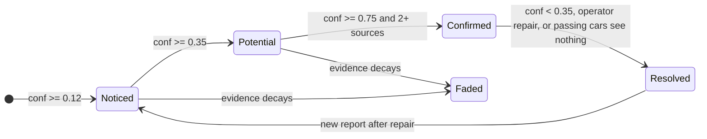

| Source | Reliability | | Hazard | Half-life |
|---|---|---|---|---|
| City CCTV | 0.85 | | Pedestrian | 4 s |
| Dashcam vision | 0.80 | | Erratic vehicle | 20 s |
| Crash history | 0.75 | | Barricade | 12 h |
| Resident photo | 0.55 | | Pothole | 45 days |
| Phone accelerometer | 0.45 | | Unmarked speed breaker | 1 year |
| Swerve cluster | 0.40 | | Unknown obstacle | 30 min |

**Driver relevance** keeps only threats on the route, ahead, in or next to the driver's lane, within the horizon. A confirmed threat in your lane inside 1.8 × stopping distance (longer when Open-Meteo reports rain) is **critical**; potential ones are spoken as "possible". Full detail: [docs/ENGINE.md](docs/ENGINE.md).

---

## Built with

| Layer | Tools (all free and open source unless noted) |
|---|---|
| App | Vite 8, React 19, TypeScript, wouter, Zustand |
| 3D | three.js r187, React Three Fiber 9, drei, postprocessing (N8AO, Bloom, AgX), 3d-tiles-renderer |
| UI | Tailwind CSS v4, shadcn/ui (restyled), React Bits (VariableProximity), Motion, Phosphor icons |
| Type | Mona Sans (variable width), Martian Mono, self-hosted |
| Sensing | MediaPipe Face Landmarker and Object Detector, CLIP via transformers.js (all on device), DeviceMotion, Geolocation, camera capture |
| Data | OpenStreetMap via Overpass, Esri World Imagery, Open-Meteo, Poly Haven (CC0), CesiumMan (CC-BY 4.0) |
| Optional | Google Photorealistic 3D Tiles (your key), Upstash Redis on Vercel for cross-device sync |

---

## Run it

```bash
cd app
npm install
npm run dev          # http://localhost:5173 (5174 with the bundled launch config)
npm test             # engine unit tests
npm run build        # production build
npm run data         # refresh OSM data for the corridor
node scripts/fetch-assets.mjs   # re-download HDRIs, textures and the walking figure
```

Optional `app/.env.local`:

```bash
VITE_GOOGLE_MAPS_API_KEY=...   # Google Photorealistic 3D Tiles (Map Tiles API enabled, restrict by referrer)
```

**Deploy on Vercel:** import this repository, set the root directory to `app` (framework, build and rewrites are in [`app/vercel.json`](app/vercel.json)). Add the Upstash Redis integration to link devices: a report or a shake on any phone then appears on every screen within seconds. Details in [docs/DEMO.md](docs/DEMO.md).

Keys `0` to `6` switch surfaces on any screen.

---

## Repository map

```text
app/
  api/events.ts            Vercel Function: shared event log (Upstash Redis), optional
  scripts/                 fetch-osm, fetch-assets, copy runtime decoders
  public/data/             corridor.json (OSM, local metres)
  public/assets/           HDRIs, PBR textures, walking figure (see CREDITS.txt)
  src/engine/              fusion, implicit obstacles, driver relevance, tests
  src/world/               corridor geometry, scenario, shared clock, live store
  src/three/               scene, shaders, canvases, realism/ (vehicles, street, ground, walkers)
  src/product/             console, HUD, in-dash, phone screens, Fusion Lab
  src/surfaces/            /twin /ops /drive /car /app /director
  src/pages/               Landing (/), showcase sections
  src/sense/               fatigue, motion, location, weather
  src/sync/                events store, BroadcastChannel and cross-device sync
docs/                      architecture, engine, design, data, demo, roadmap, plan
```

## Documentation

| Doc | What it covers |
|---|---|
| [ARCHITECTURE](docs/ARCHITECTURE.md) | Layers, shared clock, data flow, routes, sync |
| [ENGINE](docs/ENGINE.md) | Fusion maths, parameters, lifecycle, relevance, tests |
| [DESIGN](docs/DESIGN.md) | The Live Survey Sheet visual system, realism pipeline, rules |
| [DATA](docs/DATA.md) | Every data source, licence, and what is synthetic |
| [DETECTION](docs/DETECTION.md) | On-device hazard detection: models, gate, limits |
| [DEMO](docs/DEMO.md) | The 7-minute pitch, multi-device setup, deployment |
| [ROADMAP](docs/ROADMAP.md) | Next features: real functionality and visual upgrades |
| [PLAN](docs/PLAN.md) | The original ideation and build plan |
| [AGENTS](AGENTS.md) | Context for AI coding agents working in this repo |
| [CHANGELOG](CHANGELOG.md) | What each build phase added |

---

## Credits

Map data © OpenStreetMap contributors (ODbL). Satellite imagery: Esri, Maxar, Earthstar Geographics and the GIS user community. Weather: Open-Meteo. HDRIs and textures: Poly Haven (CC0). Walking figure: CesiumMan by Cesium (CC-BY 4.0) via the Khronos glTF sample assets. Statistic: Ministry of Road Transport and Highways, *Road Accidents in India 2022*.

Built for the Maruti Suzuki Innovation × IIT Bombay E-Summit Ideathon, 2026. Maruti Suzuki and Suzuki Connect are named as the intended deployment context; this is an independent student prototype.
