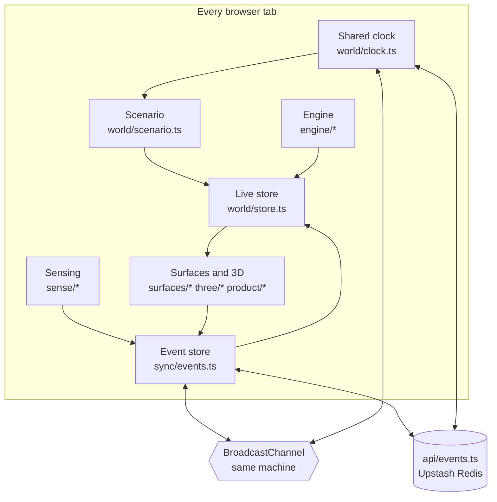

# Architecture

SuRaksha Mesh is one Vite + React single-page app with seven routes ("surfaces") that all read the same live world. There is no required backend: the only server code is an optional Vercel Function that shares events between devices.

## The shared clock

`world/clock.ts` defines engine time as `Date.now() - offset`. The scenario is a 48-second loop indexed by `engineTime mod 48 s`. Because every device uses its own wall clock, a phone, a laptop and a projector opened independently are already in step, with no server and no pairing.

- **Director** (`/director`) can pause, seek and resync. Clock state is broadcast to other tabs (BroadcastChannel) and, when configured, to other devices through `/api/events`.
- **Local override**: the landing page drives the scenario with scroll. `setOverride(t)` affects only that tab and is never broadcast.

## The world

| Module | Role |
|---|---|
| `world/corridor.ts` | Loads `public/data/corridor.json` (OSM in local metres), `Path` with `at()` and `project()`, risk field and isolines (d3-contour) |
| `world/scenario.ts` | Builds the world: chains JVLR into a route, ego and scout speed profiles, scripted sensor reports and manoeuvres, predicted risk zones, `sampleAgents(t)` |
| `world/store.ts` | Every tick (6 Hz): current loop's scripted observations + user events → implicit obstacles → `fuse()` → views projected onto the route → driver feed |

The scenario does **not** script threat states. It scripts what each sensor reports and when; the engine decides what is noticed, confirmed or resolved. User events (phone reports, shakes, operator actions, fatigue alerts) enter the same pipeline.

## Rendering

| Canvas | Used by | Notes |
|---|---|---|
| `StoryCanvas` | Landing | Camera on a Catmull-Rom path driven by scroll; near plane follows altitude |
| `HeroCanvas`, `TwinCanvas` | Showcase, `/twin` | HDRI sky, raking sun with shadows, N8AO, AgX; camera presets with `CameraControls` |
| `BevCanvas` | Ops console | Orthographic, follows the ego car, satellite under lane paint |
| `DriverCanvas` | Cockpit, in-dash see-through | Night HDRI, headlight spot, bloom on emissive lights |

`three/CityScene.tsx` composes the scene: satellite ground (or Google tiles), textured roads and kerbs, facade-shaded buildings, trees, lamps, procedural vehicles (`realism/vehicles.ts`, instanced per part), animated pedestrians, barricade set, pothole, risk terraces, sensor fans, V2V message arcs, and survey benchmarks for every threat.

Each canvas renders only while on screen (IntersectionObserver), so several live views can share a page.

## Sync

`sync/events.ts` keeps observations, manoeuvres, work orders and photo thumbnails:

1. persisted in `localStorage`
2. mirrored to other tabs with BroadcastChannel
3. when `/api/events` answers `{ configured: true }`, polled every 2 s while the page is visible and posted on every change

Events made while the device is offline go to an **outbox** in `localStorage` and are sent when the browser fires `online` or the next poll succeeds; the phone app shows how many are waiting.

**Offline shell:** `public/sw.js` (registered only in production) serves pages network-first with a cached fallback, built code and assets cache-first, and the corridor data stale-while-revalidate. With `public/manifest.webmanifest`, `/app` installs to the home screen.

`api/events.ts` stores an append-only list (last 500, 3-day TTL) and the clock in Upstash Redis via its REST pipeline. Without credentials it returns `configured: false` and the app stays per-browser.

## Routes

| Route | File | Purpose |
|---|---|---|
| `/` | `pages/Landing.tsx` | Scroll story, Fusion Lab, product sections |
| `/twin` | `surfaces/Twin.tsx` | Full-screen city twin |
| `/ops` | `surfaces/Ops.tsx` | City operations console |
| `/drive` | `surfaces/Drive.tsx` | Cockpit HUD, voice, driver monitoring |
| `/car` | `surfaces/CarScreen.tsx` | 1920 × 720 in-dash screen |
| `/app` | `surfaces/PhoneApp.tsx` | Driver and citizen phone app |
| `/director` | `surfaces/Director.tsx` | Demo control |

All routes are lazy-loaded; the 3D chunk (~450 kB gzipped) loads only when needed.
