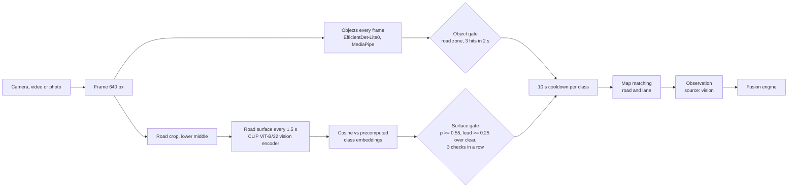

# On-device hazard detection (Dashcam AI)

`/dashcam` turns a phone on the dashboard, or any dashcam video or photo, into a connected-car sensor. Every frame is processed on the device; only the resulting observation (hazard type, confidence, road position) is shared. The Threat Intelligence Engine then treats it like any other dashcam: one report is "possible", a second independent source confirms it.

## Models

| Tier | Model | Size | Runs | Detects |
|---|---|---|---|---|
| Objects | MediaPipe Object Detector, EfficientDet-Lite0 (COCO) | 7 MB | every frame, about 13 to 15 fps on a laptop GPU | person, cow, dog, horse, sheep (reported); vehicles (drawn, not reported) |
| Road surface | CLIP ViT-B/32 vision encoder, int8 ONNX via transformers.js | 89 MB, downloaded once and cached | every 1.5 s, WebGPU with WASM fallback | pothole, barricade, cones, waterlogging, clear road |

The CLIP text side is computed once by `scripts/clip-labels.mjs` (18 prompts averaged into 5 class embeddings, saved as `src/sense/clip-labels.json`). Phones download only the vision encoder.

## The gate (`src/sense/gate.ts`)

| Rule | Why |
|---|---|
| Objects must be inside the road-ahead zone (low and central in the frame) | People on the footpath far from the carriageway are not a lane hazard |
| 3 sightings of a class within 2 s | One-frame flickers are not reported |
| Surface class must reach 55% and lead "clear road" by 25 points, 3 checks in a row | Zero-shot CLIP is a screen, not a verdict; false potholes cost trust |
| 10 s cooldown per class | One pothole is one report, not forty |

Unit tests: `src/sense/gate.test.ts`.

## Honest limits

- **Not validated on Indian road photos yet.** In tests on our rendered scenes, CLIP put "pothole" or "barricade" at 38 to 45 percent; the gate correctly held those back. The next step is a detector fine-tuned on RDD2022 (road damage, including Indian roads), exported to ONNX and run with onnxruntime-web on WebGPU.
- EfficientDet-Lite0 is a small COCO model: good for people and animals at dashcam range, weaker for small or distant objects.
- Positions come from the phone's GPS when inside the corridor, otherwise a demo spot on JVLR, then map-matched to a lane.

## Privacy

Frames, video and photos never leave the device. Only hazard type, confidence and map-matched position are sent.
